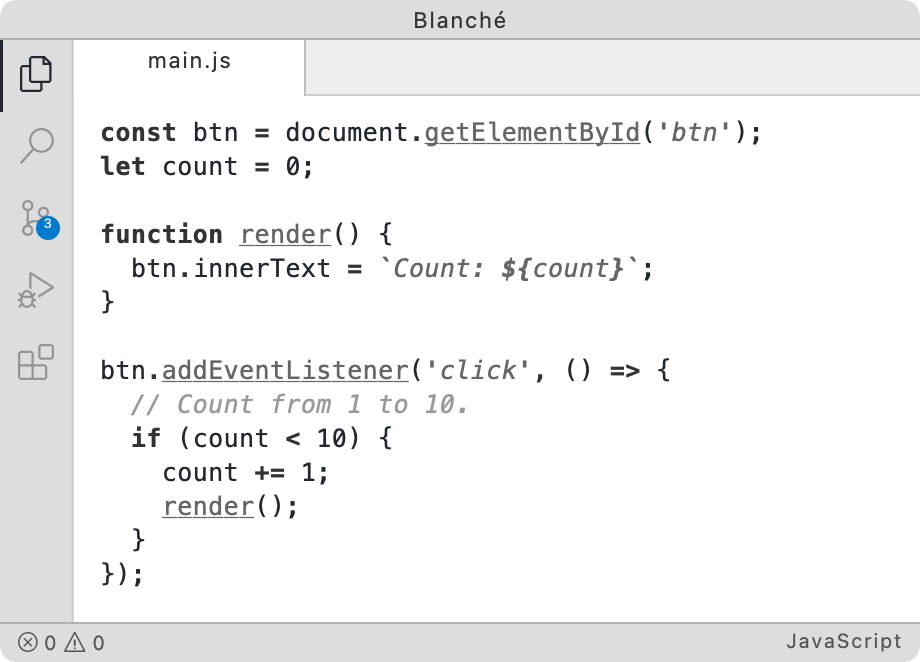

# Blanche

A calm, minimal light theme for VS Code. `Blanche` keeps the editor close to monochrome, using type styles to give code structure and a little color where it helps.

[](./package.json) [](./LICENSE)

## What it looks like



*Preview from [VS Code Themes](https://vscodethemes.com/e/shytikov.blanche/blanche).*

## Install

Install **Blanche** from the [Visual Studio Marketplace](https://marketplace.visualstudio.com/items?itemName=shytikov.blanche), or run:

```sh
code --install-extension shytikov.blanche
```

Then open **Preferences: Color Theme** and select **Blanche**.

## Inspiration

`Blanche` is a [fancy perfume from the Swedish brand Byredo](https://www.byredo.com/c/perfume/best-sellers/blanche). It's a delicate and sophisticated fragrance that evokes a sense of calm and purity. Legend says it was designed for the company owner's partner, who actually hated any scents. It was a scandal — how can you date a "perfumer" when you hate perfumes? The answer was something very tender and minimalistic, created to suit a person who cannot stand strong aromas. Its quiet, pared-back feel inspired a theme that lets typography carry much of the visual rhythm.

## Design Philosophy

* Emphasize just enough only what really matters.

## Neovim

I'm developing the Neovim version while using it daily. You can find it in the [`colors/`](./colors/) directory.
